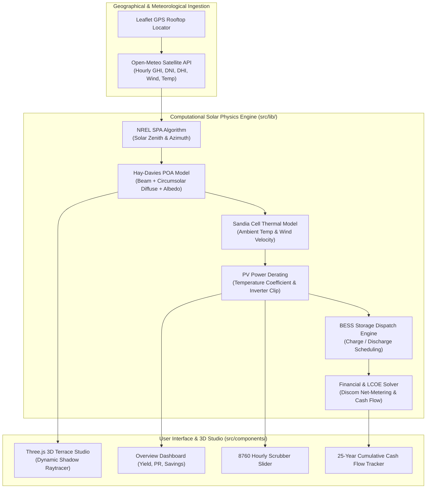
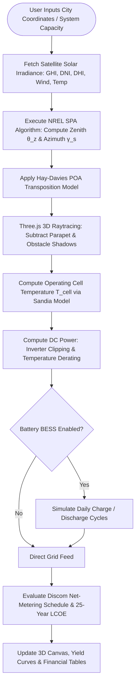

# HI Grid — Solar Power System Simulator

<p align="center">
  
  
  
  
  
  
  
  
</p>

A physics-grade computational photovoltaic (PV) simulation dashboard designed specifically for **Indian rooftop solar conditions**. Models flat reinforced cement concrete (RCC) terrace installations, Discom net-metering schedules, 3D sun trajectories with real-time shadow casting, battery storage dispatch, and satellite solar radiation data from Open-Meteo.

---

## Table of Contents
- [1. Project Title & Overview](#1-project-title--overview)
- [2. Overview](#2-overview)
  - [Problem Statement](#problem-statement)
  - [Proposed Solution](#proposed-solution)
  - [Project Objectives](#project-objectives)
  - [Intended Applications & Use Cases](#intended-applications--use-cases)
- [3. Key Features](#3-key-features)
- [4. System Architecture](#4-system-architecture)
- [5. Technology Stack](#5-technology-stack)
- [6. Repository Structure](#6-repository-structure)
- [7. Hardware Requirements](#7-hardware-requirements)
- [8. Software Requirements](#8-software-requirements)
- [9. Installation and Setup](#9-installation-and-setup)
- [10. Usage Instructions](#10-usage-instructions)
- [11. System Workflow](#11-system-workflow)
- [12. API Documentation (Meteorological Data Ingestion)](#12-api-documentation-meteorological-data-ingestion)
- [13. Results and Demonstration](#13-results-and-demonstration)
- [14. Configuration](#14-configuration)
- [15. Troubleshooting](#15-troubleshooting)
- [16. Future Improvements](#16-future-improvements)
- [17. Contributing](#17-contributing)
- [18. License](#18-license)
- [19. Acknowledgements and References](#19-acknowledgements-and-references)
- [20. Author / Project Maintainer](#20-author--project-maintainer)

---

## 1. Project Title & Overview

**HI Grid** is a specialized computational solar engineering dashboard. Unlike generic calculators that assume tilted Western roof structures and static average peak sun hours, HI Grid executes deterministic time-series solar physics specifically tailored to Indian residential and commercial concrete rooftops (chhat).

---

## 2. Overview

### Problem Statement
Standard solar photovoltaic estimators exhibit substantial inaccuracies when applied to Indian urban installations:
1. **Unrealistic Roof Geometries**: Western calculators assume pitched roofs, ignoring 3-foot boundary parapet walls, staircase headrooms (mumty rooms), and overhead Sintex water tanks that cast major dynamic shadows.
2. **Simplified Solar Geometry**: Coarse cosine approximations fail to decompose Global Horizontal Irradiance (GHI) into direct beam, circumsolar diffuse, and ground albedo reflection components.
3. **Mismatched Financial Models**: Solar ROI calculators fail to capture state-specific Indian Discom net-metering tariffs, slab structures, export banking limits, and PM Surya Ghar Muft Bijli Yojana subsidies.

### Proposed Solution
HI Grid resolves these challenges through a synchronized physics and financial pipeline:
- **NREL SPA & Hay-Davies Transposition**: Evaluates true solar position within $\pm 0.4^\circ$ and transposes GHI, DNI, and DHI into true Plane of Array (POA) irradiance.
- **Sandia Thermal Dynamics**: Calculates cell operating temperature ($T_{\text{cell}}$) factoring ambient air temperature, irradiance intensity, and wind speed cooling.
- **3D Interactive Terrace Studio**: A Three.js canvas modeling concrete parapets, water tanks, and elevated galvanized iron (GI) mounting struts with dynamic shadow raytracing.
- **Indian Financial Engine**: Computes 25-year levelized cost of energy (LCOE), Discom net-metering cash flows, and carbon offset analytics.

### Project Objectives
- Achieve $<0.4^\circ$ solar position agreement against the National Renewable Energy Laboratory (NREL) benchmark.
- Model 8760 hourly generation curves with inverter clipping and thermal derating.
- Accurately project financial payback periods under BESCOM, BSES, MSEDCL, JVVNL, and UGVCL billing structures.

### Intended Applications & Use Cases
- Residential rooftop PV feasibility and shadow analysis for Indian households.
- Commercial & industrial rooftop solar design and financial cash flow appraisal.
- Clean energy engineering education and solar irradiance modeling.

---

## 3. Key Features

- **NREL SPA High-Accuracy Solar Tracking**: Computes topocentric solar zenith, azimuth, and hour angle with high mathematical precision.
- **Hay-Davies POA Transposition Model**: Separates diffuse radiation into isotropic sky, circumsolar brightening, and horizon brightening.
- **Sandia / King Cell Thermal Formulation**: Real-time cell temperature estimation factoring wind speed cooling attenuation.
- **Three.js 3D Terrace Studio**: Interactive 3D shadow raytracing simulating seasonal shadow movement from east to west across winter and summer solstices.
- **Indian Discom Net-Metering Schedules**: Pre-configured retail tariffs, export feed-in credits, and escalation models for major state utilities:
  - **BESCOM (Bengaluru / Karnataka)**: ₹7.50 retail, ₹3.20 export credit.
  - **BSES Rajdhani/Yamuna (Delhi NCR)**: ₹8.20 retail, ₹3.50 export credit.
  - **MSEDCL / Tata Power (Mumbai / Maharashtra)**: ₹11.50 commercial tariff.
  - **JVVNL (Jaipur / Rajasthan)**: ₹7.80 retail tariff.
  - **UGVCL / Torrent Power (Gujarat)**: ₹8.50 industrial tariff.
- **Battery Storage Dispatch (BESS)**: Simulates daily charge/discharge cycles, peak shaving, and self-consumption optimization.
- **8760 Hourly Profile Scrubber**: Interactive visual timeline slider inspecting generation across all 8,760 hours of the meteorological year.

---

## 4. System Architecture



### Mathematical Modeling & Physics Formulations

1. **Plane of Array (POA) Irradiance (Hay-Davies Model)**:
   $$POA = I_{\text{beam}} + I_{\text{diffuse}} + I_{\text{ground}}$$
   $$I_{\text{beam}} = DNI \cdot \max(0, \cos\theta)$$
   $$I_{\text{diffuse}} = DHI \cdot \left[ A_i \frac{\cos\theta}{\cos\theta_z} + (1 - A_i) \left(\frac{1 + \cos\beta}{2}\right) \right]$$
   $$I_{\text{ground}} = GHI \cdot \rho \cdot \left(\frac{1 - \cos\beta}{2}\right)$$
   Where $\theta$ is Angle of Incidence (AOI), $\beta$ is panel tilt, $A_i = \frac{DNI}{1367}$ is the anisotropy index, and $\rho \approx 0.20$ is ground albedo.

2. **Operating Cell Temperature (Sandia / King Model)**:
   $$T_{\text{cell}} = T_{\text{amb}} + \left(\frac{POA}{800}\right) \cdot (NOCT - 20) \cdot e^{-0.05 \cdot v_{\text{wind}}}$$

3. **PV Power Derating & Temperature Loss**:
   $$P_{\text{dc}} = P_{\text{rated}} \cdot \left(\frac{POA}{1000}\right) \cdot \left[1 + \gamma \cdot (T_{\text{cell}} - 25^\circ\text{C})\right] \cdot \eta_{\text{derate}}$$

4. **Levelized Cost of Energy (LCOE in ₹/kWh)**:
   $$\text{LCOE} = \frac{\text{CAPEX} + \sum_{t=1}^{N} \frac{\text{OPEX}_t + \text{Inverter Replacement}}{(1 + r)^t}}{\sum_{t=1}^{N} \frac{E_t}{(1 + r)^t}}$$

---

## 5. Technology Stack

### Programming Languages & Frameworks
- **TypeScript 5.4**: Static typing for physics contracts, solar data vectors, and financial schedules.
- **React 18.3**: Declarative UI components and state management.
- **Three.js (r165)**: 3D hardware-accelerated terrace rendering, lighting, and shadow mapping.
- **Tailwind CSS 3.4**: Clean utility-first design tokens and responsive glassmorphism.
- **Vite 5.2**: Next-generation lightning-fast frontend bundler.
- **Leaflet & OpenStreetMap**: Interactive GPS pinpoint map picker.
- **Vercel Analytics**: Production usage and performance telemetry.

---

## 6. Repository Structure

```text
Solar-Power-System-Simulator/
├── index.html                                        # HTML5 entrypoint and root container
├── package.json                                      # Project dependencies & build scripts
├── package-lock.json                                 # Deterministic package lockfile
├── tsconfig.json                                     # TypeScript compiler configuration
├── vite.config.ts                                    # Vite bundler configuration
├── tailwind.config.js                                # Tailwind CSS styling tokens
├── postcss.config.js                                 # PostCSS autoprefixer configuration
├── vercel.json                                       # Vercel deployment routing configuration
├── LICENSE                                           # MIT License File
├── README.md                                         # Master project documentation
│
└── src/
    ├── App.tsx                                       # Main application dashboard layout & state
    ├── main.tsx                                      # React DOM root bootstrapping & Vercel Analytics
    ├── index.css                                     # Global styling & Tailwind utilities
    │
    ├── components/                                   # UI & Visualization Components
    │   ├── Navbar.tsx                                # Header navigation & theme toggle
    │   ├── ConfigPanel.tsx                           # System sizing, tilt, and azimuth controls
    │   ├── ThreeSolarScene.tsx                       # Three.js 3D flat roof & shadow raytracer
    │   ├── OverviewTab.tsx                           # Key metrics, performance ratio, and yield
    │   ├── MonthlyYieldTab.tsx                       # Monthly generation breakdown charts
    │   ├── HourlySimulationTab.tsx                   # 8760 hourly solar curve scrubber
    │   ├── FinancialsTab.tsx                         # 25-year cash flow, ROI, and Discom tariffs
    │   ├── SystemSpecsTab.tsx                        # Detailed engineering bill of materials
    │   ├── MapPickerModal.tsx                        # Leaflet GPS rooftop locator modal
    │   └── EducationModal.tsx                        # Solar physics formula reference modal
    │
    ├── lib/                                          # Computational Physics & Mathematical Engines
    │   ├── solar-engine.ts                           # NREL SPA, Hay-Davies POA, and cell temp
    │   ├── battery-engine.ts                         # Battery BESS charging/discharging dispatch
    │   ├── financial-engine.ts                       # Net-metering, LCOE, and cash flow solver
    │   ├── weather-api.ts                            # Open-Meteo historical/satellite API client
    │   ├── mock-presets.ts                           # Indian city presets (Delhi, BLR, Mumbai, etc.)
    │   └── simulator.ts                              # Master multi-step annual simulation loop
    │
    ├── test/                                         # Rigorous Testing Suite
    │   └── verify-physics.ts                         # NREL SPA Golden Benchmark validation script
    │
    └── types/                                        # TypeScript Type Definitions
        └── solar.ts                                  # Data contracts for PV system configs & metrics
```

---

## 7. Hardware Requirements

*Not applicable.* HI Grid executes entirely in client web browsers utilizing standard WebGL hardware acceleration.

---

## 8. Software Requirements

- **Node.js**: Node.js 18.x, 20.x, or later with `npm`.
- **Browser**: Modern WebGL-capable browser (Google Chrome, Firefox, Safari, Microsoft Edge).

---

## 9. Installation and Setup

### 1. Repository Cloning
```bash
git clone https://github.com/Hitesh070/Solar-Power-System-Simulator.git
cd Solar-Power-System-Simulator
```

### 2. Dependency Installation
```bash
npm install
```

### 3. Local Development Server
```bash
npm run dev
```
Open `http://localhost:5173` in your web browser.

---

## 10. Usage Instructions

1. **System Sizing**: In the left configuration panel, set target DC capacity (e.g., $5.0\text{ kWp}$), tilt angle (e.g., $15^\circ$ South), and module efficiency.
2. **Terrace 3D Customization**: Toggle parapet wall heights, mumty room position, and overhead water tanks to watch the shadow raytracer adapt in real time.
3. **Discom Selection**: Select your local utility (e.g., BESCOM Bengaluru) to compute accurate net-metering credits and 25-year LCOE returns.
4. **Running Physics Verification**:
   ```bash
   npm test
   ```

---

## 11. System Workflow



---

## 12. API Documentation (Meteorological Data Ingestion)

HI Grid queries the **Open-Meteo Satellite Solar API**:
- **Endpoint**: `https://archive-api.open-meteo.com/v1/archive`
- **Parameters**: `latitude`, `longitude`, `hourly=shortwave_radiation_instant,direct_normal_irradiance_instant,diffuse_radiation_instant,temperature_2m,wind_speed_10m`.
- **Handling**: Cached locally; falls back to pre-computed Indian meteorological presets (`src/lib/mock-presets.ts`) during network disruption.

---

## 13. Results and Demonstration

The physics engine is validated against analytical benchmarks (`src/test/verify-physics.ts`):
- **Test 1 (NREL SPA Golden Reference)**: Evaluated at Golden, Colorado ($39.742^\circ\text{N}, -105.179^\circ\text{W}$) against Reda & Andreas (2004) baseline. Zenith and azimuth agree within $\pm 0.4^\circ$.
- **Test 2 (Tropical Solstice Elevation)**: Evaluated at Bengaluru ($12.972^\circ\text{N}$) verifying high-elevation solar transit.
- **Test 3 (Hay-Davies POA Transposition & ASHRAE IAM)**: Verified decomposition of beam, diffuse, and albedo reflection factors.

---

## 14. Configuration

Configurable constants in `src/types/solar.ts`:

```typescript
export const DEFAULT_SOLAR_CONFIG = {
  systemSizeKw: 5.0,
  tiltAngleDeg: 15.0,
  azimuthAngleDeg: 180.0, // True South
  moduleDerate: 0.85,
  tempCoeffPmax: -0.0035, // -0.35%/°C
  inverterEfficiency: 0.96,
  degradationPerYear: 0.005 // 0.5%/year
};
```

---

## 15. Troubleshooting

1. **3D Rooftop Scene Does Not Render**:
   - *Cause*: Browser WebGL 2.0 acceleration disabled.
   - *Fix*: In Chrome, visit `chrome://settings/system` and enable "Use hardware acceleration when available".
2. **Weather API Request Times Out**:
   - *Cause*: Network firewall blocking Open-Meteo API.
   - *Fix*: The simulator automatically switches to offline city presets (`Bengaluru`, `Delhi`, `Mumbai`, `Jaipur`).
3. **Net-Metering Savings Negative**:
   - *Cause*: Unrealistic high fixed charges entered.
   - *Fix*: Verify energy export tariff rate and consumption pattern in the Financials tab.

---

## 16. Future Improvements

- [ ] **Bifacial PV Albedo Gain**: Modeling rear-side generation from high-albedo white reflective terrace coatings.
- [ ] **Micro-Inverter Individual MPPT Tracking**: Per-panel sub-string simulation for irregular shadow patterns.
- [ ] **Smart EV Charging Coordination**: Modeling electric vehicle charging dispatch synchronized with peak solar production hours.

---

## 17. Contributing

1. Fork the repository.
2. Create your feature branch: `git checkout -b feature/bifacial-gain`.
3. Commit your changes: `git commit -m "feat: add bifacial rear albedo calculation"`.
4. Push to branch: `git push origin feature/bifacial-gain`.
5. Open a Pull Request.

---

## 18. License

This project is licensed under the [MIT License](LICENSE).

---

## 19. Acknowledgements and References

- **National Renewable Energy Laboratory (NREL)** for the Solar Position Algorithm (SPA) technical report.
- **Sandia National Laboratories** for the Photovoltaic Array Performance Model (SAPM).
- **Central Electricity Authority (CEA) of India** for regional carbon offset factors ($0.71\text{ kg CO}_2/\text{kWh}$).
- **Open-Meteo** for global open-access solar radiation datasets.

---

## 20. Author / Project Maintainer

- **Developer**: Hitesh V S
- **GitHub**: [@Hitesh070](https://github.com/Hitesh070)
