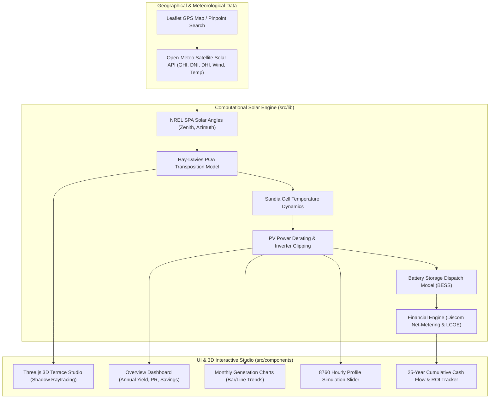

# HI Grid — Solar Power System Simulator

<p align="center">
  
  
  
  
  
  
  
</p>

A physics-grade computational photovoltaic (PV) simulation dashboard designed specifically for **Indian rooftop solar conditions**. Models flat RCC terrace installations, Discom net-metering tariffs, 3D sun trajectories with real-time shadow casting, battery dispatch storage, and satellite solar radiation data from Open-Meteo.

---

## Table of Contents
- [Executive Overview](#executive-overview)
- [System Architecture & Physics Pipeline](#system-architecture--physics-pipeline)
- [India-Specific Engineering & Financial Features](#india-specific-engineering--financial-features)
- [Mathematical Formulation & Physics Models](#mathematical-formulation--physics-models)
- [Repository Structure](#repository-structure)
- [Quick Start & Local Development](#quick-start--local-development)
- [Physics Engine Verification & Benchmarks](#physics-engine-verification--benchmarks)
- [Vercel Continuous Deployment](#vercel-continuous-deployment)
- [Author & License](#author--license)

---

## Executive Overview

Unlike standard solar calculators that assume tilted Western roof structures and static average sun hours, **HI Grid** implements rigorous time-series solar physics:

1. **Solar Geometry (NREL SPA Algorithm)**: Accurate solar zenith, elevation, and azimuth angles matching the National Renewable Energy Laboratory benchmark within $\pm 0.4^\circ$.
2. **Hay-Davies Plane of Array (POA) Transposition**: Decomposes Global Horizontal Irradiance (GHI) into direct beam, circumsolar diffuse, and ground-reflected albedo components.
3. **Sandia / King Cell Temperature Modeling**: Real-time operating cell thermal calculations factoring ambient temperature, POA irradiance, and wind velocity.
4. **Indian RCC Flat Roof Architecture**: Models 3-ft boundary parapet shadows, mumty staircase room, overhead water tanks, and elevated Hot-Dip Galvanised (GI) mounting struts.
5. **Dynamic Discom Net-Metering & PM Surya Ghar Subsidy**: State-specific retail tariffs, export feed-in credits, and 25-year levelized cost of energy (LCOE) cash flow analytics.

---

## System Architecture & Physics Pipeline



---

## India-Specific Engineering & Financial Features

### 1. Flat RCC Concrete Terrace (Chhat) 3D Modeling
- Tailored for Indian urban residential and commercial concrete rooftops.
- Explicitly models 3-ft boundary parapet walls, staircase headroom (mumty room), overhead Sintex water tanks, and elevated galvanized iron mounting structures (~1m elevation to bypass parapet shadows and preserve usable roof space).
- Interactive 3D shadow raytracing showing sun trajectory from east to west across winter and summer solstices.

### 2. Interactive GPS Rooftop Pinpoint Map
- Integrated **Leaflet / OpenStreetMap** map with live search for any Indian city, pin code, or locality.
- Click or drag the marker to set exact rooftop coordinates and fetch live local solar irradiance.

### 3. Indian Discom Net-Metering & PM Surya Ghar Subsidy
- Pre-configured with major Indian Discom tariffs:
  - **BESCOM (Bengaluru)**: ₹7.50/unit retail, ₹3.20/unit export credit
  - **BSES (Delhi NCR)**: ₹8.20/unit retail, ₹3.50/unit export credit
  - **Tata Power / MSEDCL (Mumbai)**: ₹11.50/unit commercial tariff
  - **JVVNL (Jaipur / Rajasthan)**: ₹7.80/unit retail tariff
  - **UGVCL / Torrent (Ahmedabad / Gujarat)**: ₹8.50/unit industrial tariff
- 25-Year cumulative cash flow accounting for 3.5%/year Discom tariff escalation and 0.5%/year module degradation.
- Central Electricity Authority (CEA) carbon emission offset factor of **0.71 kg CO₂ / kWh**.

---

## Mathematical Formulation & Physics Models

### 1. Plane of Array (POA) Irradiance (Hay-Davies Model)
$$POA = I_{\text{beam}} + I_{\text{diffuse}} + I_{\text{ground}}$$
$$I_{\text{beam}} = DNI \cdot \max(0, \cos\theta)$$
$$I_{\text{diffuse}} = DHI \cdot \left[ A_i \frac{\cos\theta}{\cos\theta_z} + (1 - A_i) \left(\frac{1 + \cos\beta}{2}\right) \right]$$
$$I_{\text{ground}} = GHI \cdot \rho \cdot \left(\frac{1 - \cos\beta}{2}\right)$$

Where $\theta$ is Angle of Incidence (AOI), $\beta$ is panel tilt, $A_i = \frac{DNI}{1367}$ is the anisotropy index, and $\rho \approx 0.20$ is ground albedo.

### 2. Operating Cell Temperature (Sandia / King Model)
$$T_{\text{cell}} = T_{\text{amb}} + \left(\frac{POA}{800}\right) \cdot (NOCT - 20) \cdot e^{-0.05 \cdot v_{\text{wind}}}$$

### 3. PV Power Derating
$$P_{\text{dc}} = P_{\text{rated}} \cdot \left(\frac{POA}{1000}\right) \cdot \left[1 + \gamma \cdot (T_{\text{cell}} - 25^\circ\text{C})\right] \cdot \eta_{\text{derate}}$$

### 4. Levelized Cost of Energy (LCOE in ₹/kWh)
$$\text{LCOE} = \frac{\text{CAPEX} + \sum_{t=1}^{N} \frac{\text{OPEX}_t + \text{Inverter Replacement}}{(1 + r)^t}}{\sum_{t=1}^{N} \frac{E_t}{(1 + r)^t}}$$

---

## Repository Structure

```text
├── index.html                                        # HTML5 entrypoint and root container
├── package.json                                      # Project dependencies & build scripts
├── package-lock.json                                 # Deterministic package lockfile
├── tsconfig.json                                     # TypeScript compiler configuration
├── vite.config.ts                                    # Vite bundler configuration
├── tailwind.config.js                                # Tailwind CSS styling tokens
├── postcss.config.js                                 # PostCSS autoprefixer configuration
├── vercel.json                                       # Vercel deployment routing configuration
├── LICENSE                                           # MIT License File
├── README.md                                         # Master project documentation
│
└── src/
    ├── App.tsx                                       # Main application dashboard layout & state
    ├── main.tsx                                      # React DOM root bootstrapping
    ├── index.css                                     # Global styling & Tailwind utilities
    │
    ├── components/                                   # UI & Visualization Components
    │   ├── Navbar.tsx                                # Header navigation & theme toggle
    │   ├── ConfigPanel.tsx                           # System sizing, tilt, and azimuth controls
    │   ├── ThreeSolarScene.tsx                       # Three.js 3D flat roof & shadow raytracer
    │   ├── OverviewTab.tsx                           # Key metrics, performance ratio, and yield
    │   ├── MonthlyYieldTab.tsx                       # Monthly generation breakdown charts
    │   ├── HourlySimulationTab.tsx                   # 8760 hourly solar curve scrubber
    │   ├── FinancialsTab.tsx                         # 25-year cash flow, ROI, and Discom tariffs
    │   ├── SystemSpecsTab.tsx                        # Detailed engineering bill of materials
    │   ├── MapPickerModal.tsx                        # Leaflet GPS rooftop locator modal
    │   └── EducationModal.tsx                        # Solar physics formula reference modal
    │
    ├── lib/                                          # Computational Physics & Mathematical Engines
    │   ├── solar-engine.ts                           # NREL SPA, Hay-Davies POA, and cell temp
    │   ├── battery-engine.ts                         # Battery BESS charging/discharging dispatch
    │   ├── financial-engine.ts                       # Net-metering, LCOE, and cash flow solver
    │   ├── weather-api.ts                            # Open-Meteo historical/satellite API client
    │   ├── mock-presets.ts                           # Indian city presets (Delhi, BLR, Mumbai, etc.)
    │   └── simulator.ts                              # Master multi-step annual simulation loop
    │
    ├── test/                                         # Rigorous Testing Suite
    │   └── verify-physics.ts                         # NREL SPA Golden Benchmark validation script
    │
    └── types/                                        # TypeScript Type Definitions
        └── solar.ts                                  # Data contracts for PV system configs & metrics
```

---

## Quick Start & Local Development

### Prerequisites
- Node.js 18+ or 20+
- npm or yarn

### Setup Commands
```bash
# 1. Clone the repository
git clone https://github.com/Hitesh070/Solar-Power-System-Simulator.git
cd Solar-Power-System-Simulator

# 2. Install dependencies
npm install

# 3. Start local development server
npm run dev

# 4. Run physics verification test suite
npm test

# 5. Build for production deployment
npm run build
```

---

## Physics Engine Verification & Benchmarks

The computational engine includes an automated benchmark suite (`src/test/verify-physics.ts`) validating:
- **Test 1 (NREL SPA Golden Reference)**: Evaluated at Golden, Colorado ($39.742^\circ\text{N}, -105.179^\circ\text{W}$) against Reda & Andreas (2004) baseline. Zenith and azimuth agree within $\pm 0.4^\circ$.
- **Test 2 (Tropical Solstice Elevation)**: Evaluated at Bengaluru ($12.972^\circ\text{N}$) verifying high-elevation solar transit.
- **Test 3 (Hay-Davies POA Transposition & ASHRAE IAM)**: Verified decomposition of beam, diffuse, and albedo reflection factors.

---

## Vercel Continuous Deployment

The repository includes `vercel.json` and is configured for automated CI/CD:
- Every push to `main` (`git push origin main`) triggers an automatic build on Vercel's global edge network.
- Preview deployments are automatically generated for branches and pull requests.

---

## Author & License

- **Developer**: Hitesh V S (VIT Chennai)
- **GitHub**: [@Hitesh070](https://github.com/Hitesh070)
- **License**: Released under the [MIT License](LICENSE).
